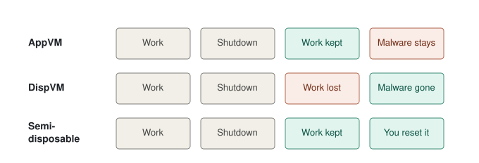
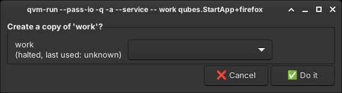
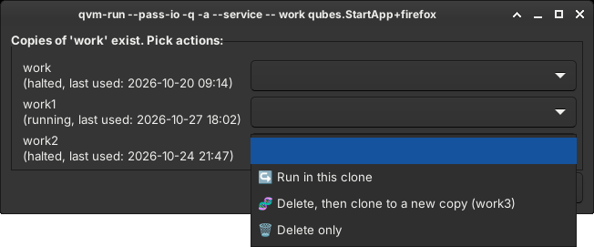
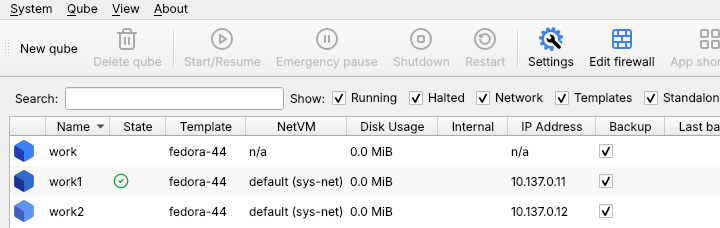

# Semidisposable VMs: extra security layer for Qubes OS

<details>
<summary><h3><b>What is Qubes OS?</b> </h3></summary>

> Qubes OS is a security-focused desktop operating system that aims to provide security through compartmentalization.
> <br/><sub>[Wikipedia](https://en.wikipedia.org/wiki/Qubes_OS)</sub>

<br/>

<br/><sub><i>Each qube's windows get a frame in its label's color. Source: <a href="https://doc.qubes-os.org/en/r4.3/introduction/screenshots.html">Qubes OS documentation</a></i></sub>

<br/>

Qubes OS encourages you to divide your computer work into isolated VMs of different types, called **qubes**, for example:

-  **AppVM**: has a persistent `/home` (and some other directories, e.g. `/usr/local`); everything else is reset on each qube shutdown.
-  **DispVM**: a disposable qube; each shutdown wipes out all changes in its filesystem.

</details>

### The problem with AppVMs 

People typically use **AppVMs** for their regular everyday work. But isn't the Qubes OS architecture being **underused** that way? What happens if your home directory gets **infected**? Many modern apps are being updated without *sudo*, or store executables inside the home directory (like Firefox, for example), which means that compromising them may be **persistent**.

### The problem with DispVMs 

Yes, using **disposable VMs** is a solution to the problem above, but is also very **inconvenient**. Whatever you do, your local work will **never survive** an unexpected power outage, nor a mistaken shutdown of the VM.

### The solution: Semidisposable VMs 

What if we could still have the convenience of *not having to think about backing up all local work*, and the security of *all (future) infections being temporary*? A **semidisposable VM** is, in essence, a disposable VM that **doesn't get disposed** on every **shutdown**. Instead, you get to manually decide when exactly it happens.



In practice:

- Each AppVM (except for the `sys-` qubes) becomes a *semidisposable VM* (but you can add your custom exceptions).
- When you choose to work in a **clone** of an AppVM, the base AppVM stays untouched.
- The clone keeps its state across shutdowns, so local work survives (exactly as in AppVMs).
- At any time, you can **delete and re-clone** the clone. Everything that happened inside the old clone is wiped out (exactly as in DispVMs).


## [qvm-run](qvm-run)

`qvm-run` is a wrapper around `/usr/bin/qvm-run` that makes this workflow the default. Because it has the same name and comes first in your `PATH`, it also handles apps started from the GUI (app menu, app finder), not only from the terminal. When you start an app in an AppVM, a dialog lets you choose what to do:

<br/><sub><i>First start: no copies exist yet.</i></sub>

<br/>

<br/><sub><i>With copies: one action per qube (here the actions of a halted copy).</i></sub>

<br/>

<table>
<tr>
<td width="33%" valign="top"><br/><b>Run in this clone</b><br/>Runs the command in an existing clone, keeping its state</td>
<td width="33%" valign="top"><br/><b>Clone to a new copy</b><br/>Creates a new clone of the base and runs the command there</td>
<td width="33%" valign="top"><br/><b>Stop, delete, then clone</b><br/>Stops the running clone, removes it, and clones the base again</td>
</tr>
<tr>
<td width="33%" valign="top"><br/><b>Delete, then clone</b><br/>Removes the clone and clones the base again</td>
<td width="33%" valign="top"><br/><b>Delete only</b><br/>Removes the clone</td>
<td width="33%" valign="top"><br/><b>Run in base (not recommended)</b><br/>Runs the command directly in the base AppVM</td>
</tr>
</table>

Other details:

- New copies get a shade of the base qube's label, so you can tell them apart at a glance.
- Copies get network access through their default NetVM, the base qube is set to offline.
- File copies (`qvm-copy`) are allowed **into** the copies only, never into the base.

<br/><sub><i>Part of the Qube Manager list: the base qube <code>work</code> and its copies, <code>work1</code> with a darker and <code>work2</code> with a lighter shade of its blue label.</i></sub>


### Usage

Same as the native Qubes OS `/usr/bin/qvm-run`. Example:

```bash
qvm-run -q -a --service -- work qubes.StartApp+firefox
```


### Requirements

- Qubes OS (dom0)
- `zenity` and `notify-send` (both are included by default since Qubes OS 4.3)
- [qubes-label-tt](https://github.com/alimirjamali/personal-qubesos/tree/main#qubes-label-tt-utility) (optionally, used for the shade labels)


### Installation

`qvm-run` has to be [copied to dom0](https://doc.qubes-os.org/en/latest/user/how-to-guides/how-to-copy-from-dom0.html#copying-to-dom0) (feel free to **review the code** yourself first!), then - for example by using the `install` command - made executable and put somewhere ahead of `/usr/bin/` in your `$PATH`:

```bash
install -m 755 ./qvm-run ~/bin/qvm-run
```

or:

```bash
sudo install -m 755 ./qvm-run /usr/local/bin/qvm-run
```


### License

Icons from [Qubes OS artwork](https://github.com/QubesOS/qubes-artwork) (The Invisible Things Lab), licensed under [CC BY-SA 4.0](https://creativecommons.org/licenses/by-sa/4.0/). Action icons are the emoji used in the `qvm-run` dialog, from [Noto Emoji](https://github.com/googlefonts/noto-emoji) (Apache License 2.0).
